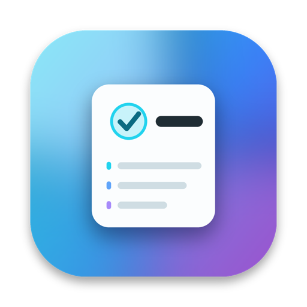
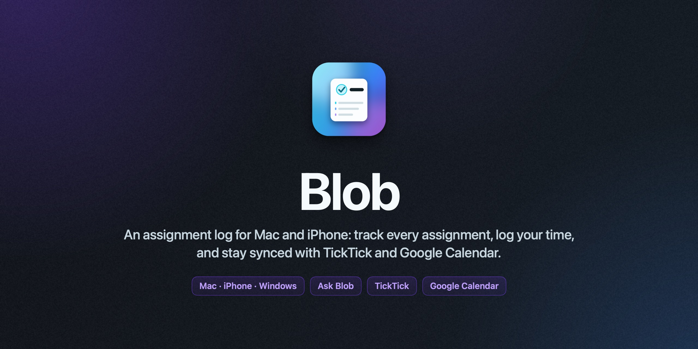

<p align="center">
  
</p>

<h1 align="center">Blob</h1>

<p align="center">
  <b>An assignment log for Mac and iPhone: track every assignment, log the time you spend and what you got done, and keep it all in sync with TickTick and Google Calendar.</b>
</p>

<p align="center">
  
  
  
  
</p>

<p align="center">
  <a href="#what-it-does">What it does</a> ·
  <a href="#1-install-on-your-mac">Install</a> ·
  <a href="#connecting-ticktick">TickTick</a> ·
  <a href="#google-calendar">Google Calendar</a> ·
  <a href="#project-layout">Project layout</a> ·
  <a href="https://github.com/arjsenani-blip/blob/releases/latest">Latest release</a>
</p>

<p align="center">
  
</p>

Blob is a native SwiftUI app; the Mac and iPhone share the same code and data.

> 2.0 dropped the voice assistant (the corner blob, voice, screen control and self-updates). Everything else got rebuilt around logging, with a new look.

## What it does

| | |
|---|---|
| **Log work** | The log card on Today (and ⌘L anywhere): pick the assignment, tap a time (15m … 2h, or any amount), add a note if you want, mark the next step or the whole thing done. You can back-date an entry ("Earlier…"). |
| **Focus timer** | ▶ on any assignment starts a timer. It shows in the sidebar, the menu bar and above the iPhone tab bar; **Log** stops it and puts the time in the work log. |
| **Type it** | Quick add (⌘K) understands logging too: `worked 45 min on the history essay` · `finished the outline for my english essay` · `history project is 60% done` · `got 92/100 on the chem lab`. And adding: `Essay due fri ~90m #English` · `History project due nov 20 long-term`. |
| **Activity** | Time today, this week, your day streak, a chart of time per class over 7/14/30 days, and the full log, grouped by day. |
| **Assignments** | Upcoming / Long-term / Classes / Done. Long-term work gets dated steps, a pace (ahead, on track, behind, at risk) and how much a day you need. Swipe or right-click any row to log or start a timer. |
| **TickTick** (Mac + iPhone) | Homework goes into a TickTick list, tagged with its class, with long-term steps as a checklist and logged time in the notes. Complete a task, check a step or move a due date in TickTick and Blob follows. Tasks you add to that list become assignments. |
| **Google Calendar** | Shows your Google calendars, and can put on them: your events, **assignment due dates**, and **logged work** (each session becomes an event on a "Blob work log" calendar, so your calendar shows where your time went). Assignments can also be Google Tasks; tick one off in Google Calendar and it's done in Blob. |
| **Google Classroom** | Pulls in assignments, due dates, turned-in/late status and grades (read-only). |
| **Apple Calendar & Reminders** | Homework in a Reminders list, due dates on any calendar on the device. |
| **Plan** | Check in and Blob lines up today's work around your events, with breaks, done by bedtime. |
| **Sync** | Mac and iPhone sync through a hidden app folder in Google Drive; newest edit wins. |
| **Look** | The Cooky design language (same as MediBro): a softly lit frame with drifting color, floating cards, tinted-glass controls, and one accent color you pick in Settings. |

## Connecting TickTick

TickTick's API needs a sign-in for your account:

- **On the Mac:** Settings → TickTick → *Connect with a developer app*. Make a free app at [developer.ticktick.com](https://developer.ticktick.com/manage), set its redirect URL to `http://127.0.0.1:8765/ticktick` (Blob shows a Copy button), paste the client ID and secret, and click **Connect TickTick**.
- **On the iPhone:** on the Mac, click **Copy TickTick sign-in for my iPhone**, then paste it into Settings → TickTick on the iPhone (Universal Clipboard works). If your TickTick account gives you an API token, you can paste that on either device instead.

Turn on **Sync homework with TickTick** on each device you want syncing; both update the same TickTick tasks, not copies.

## Google Calendar

Settings → Google Calendar → **Connect Google Calendar** on the account whose calendar you use (the first time, Blob asks for permission to make its own "Blob work log" calendar). Then turn on what you want:

- Show my Google Calendar events
- Add my Blob events to Google Calendar
- Assignments as Google Tasks
- Put assignment due dates on my Google Calendar
- Put logged work on Google Calendar

If you connected Google Calendar in an older version, click **Allow** under *Put logged work on Google Calendar* so the work log gets its own calendar instead of your main one.

## 1. Install on your Mac

Download **`Blob.dmg`** from the [latest release](https://github.com/arjsenani-blip/blob/releases/latest), open it, and drag the app into Applications (replace the old one when updating). The first time, right-click Blob → Open, because the app isn't notarized.

To rebuild after changing code, run `./scripts/build_dmg.sh` (it needs Xcode and `brew install xcodegen`).

## 2. Install on your iPhone (sideload, free Apple ID)

1. Plug your iPhone into the Mac and tap **Trust**.
2. Open the project:
   ```bash
   open ArjunsBrain.xcodeproj
   ```
3. At the top of Xcode, choose the **ArjunsBrain-iOS** scheme and select your iPhone as the device.
4. Under **Signing & Capabilities** for the iOS target, pick your team ("Arjun Senani (Personal Team)").
5. Press **▶ Run**.
6. The first time, go to iPhone **Settings → General → VPN & Device Management**, tap your Apple ID, and choose **Trust**.
7. If the iPhone asks, turn on **Developer Mode** (Settings → Privacy & Security) and restart.

> With a free Apple ID the app **expires after 7 days**. To renew it, plug in and press ▶ Run again. Your data stays because it syncs through Drive. A paid developer account ($99/yr) extends this to a year.

## 3. One-time Google setup (~5 min)

Google needs an ID for the app before it can read Classroom or Drive:

1. Go to [console.cloud.google.com](https://console.cloud.google.com) and create a project called *Blob*.
2. **APIs & Services → Library**: enable **Google Classroom API**, **Google Drive API**, **Google Calendar API** and **Google Tasks API**.
3. **OAuth consent screen**: choose External, enter the app name and your email. Under **Test users**, add your **school email** and your personal Gmail.
4. **Credentials → Create credentials → OAuth client ID**, type **iOS**, bundle ID `com.arjunsenani.brain`.
5. Copy the client ID and paste it into **Settings → Google setup** in the app, on both the Mac and the iPhone.
6. On both devices, go to **Settings → Google Classroom → Sign in with Google** and use your school account.
7. For Google Calendar: in **Settings → Google Calendar**, click **Connect Google Calendar** on the account whose calendar you use, then pick what to sync.

**If your school account gets blocked:** some school Google admins don't allow outside apps. If Classroom sign-in fails, ask your school's IT to allow the app (there's no way around that part). If Classroom works but Drive is blocked, sign a personal Gmail into **Separate sync account** on both devices.

> While the Google project is in "Testing" mode, Google signs you out about every 7 days. When that happens, tap Sign in again.

## How the check-in planner decides

1. **Time window:** from now until your "done working by" time (default 10:30 PM). If you check in after that, you get a short 60-minute session for the essentials only.
2. **Urgency:** overdue → due before tomorrow morning → due tomorrow → this week → later.
3. **Time of day:** at high-energy times (late morning, after school) the hardest work goes first. Late at night it puts important work first, then shorter and lighter tasks. If a quick task (20 min or less) is due soon, it goes first to get you started.
4. **Safety check:** if that order would make anything late, it switches to a strict earliest-deadline-first order.
5. **Breaks:** work is split into 45-minute focus blocks with 10-minute breaks. You can change all of these in Settings.

## Project layout

```
Packages/BrainCore/        Pure Swift logic + 40 unit tests (cd there and run `swift test`)
  NaturalLanguageParser    quick-add parsing
  ProgressLog              plain-English progress logging + matching your words to an assignment
  Tracking                 steps, progress, pace, grades, workload
  Scheduler                check-in timeline
  SyncMerger / Models      data + newest-wins merge
App/Shared/                SwiftUI app shared by Mac and iOS
  Services/                Google sign-in (PKCE), Classroom, Drive sync, Google Calendar/Tasks, TickTick, Apple Calendar/Reminders
  Store/BrainStore         app state, saves to ~/Library/Application Support/ArjunsBrain
  Store/+Logging           focus timer, quick log, activity totals and streak
  Views/                   Today, Assignments, Activity, Calendar, Settings, log views, editors
  Views/Theme              the Cooky design language: frame, floating cards, tinted glass, one accent
project.yml                XcodeGen spec (run `xcodegen generate` after adding files)
```
